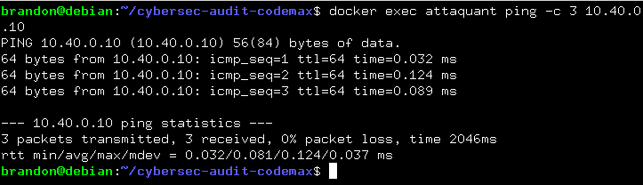
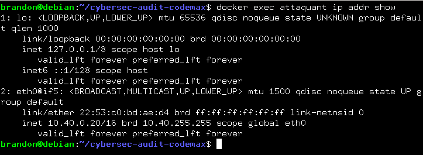

# Audit de securite - Plateforme Code un max

## 1. Perimetre
* **Cible** : `dvwa-cible` (10.40.0.10), clone de la plateforme de cours.
* **Poste d'audit** : `attaquant` (10.40.0.20).
* **Réseau** : `cyberlab-net` (10.40.0.0/16).

## 2. Roles mobilises
* **Analyste SOC** : Surveillance et détection sur le réseau du lab.
* **Pentester** : Recherche active de vulnérabilités sur `dvwa-cible`.
* **Ingénieur Sécurité Cloud** : Durcissement de l'hébergement.
* **Consultant Cybersécurité** : Synthèse et recommandations.
* **RSSI** : Arbitrage des risques, validation du plan.
* **Forensic Expert** : Analyse post-incident

## 3. Approches
* **Blue Team** : défense, détection, réaction.
* **Red Team** : simulation d'attaque offensive.

## 4. Defense en profondeur (Couches)
* **Réseau** : Segmentation via `cyberlab-net` et filtrage entre les hôtes.
* **Hôte** : surface d'attaque du conteneur `dvwa-cible`.
* **Application** : contrôles d'entrée de la plateforme web.
* **Données** : protection des informations de cours.
* **Détection** : collecte des traces pour le SOC.

## 5. Gestion des incidents et Articulation Red Team / Blue Team
* **Détection** : Réalisée par la Blue Team (SOC) via la surveillance.
* **Qualification & Analyse** : Évaluation du risque par les experts (Forensic, Consultant).
* **Réaction & Correction** : Application des correctifs par l'Ingénieur Sécurité et validation par le RSSI.
* **Conformité & Audits** : Vérification par le Pentester et les audits réguliers que les correctifs tiennent dans le temps.

## 6. Matrice de responsabilité des couches
| Couche de défense | Métier principal responsable |
| :--- | :--- |
| **Réseau** | Ingénieur Sécurité Cloud / Architecte Réseau |
| **Hôte** | Administrateur Système / Ingénieur Sécurité |
| **Application** | Développeur / Pentester (pour l'audit) |
| **Données** | Administrateur de Base de Données / RSSI |
| **Détection** | Analyste SOC / Blue Team |

## 7. Vérifier que le poste d'audit atteint la cible

**64 bytes from 10.40.0.10** puis **3 packets transmitted, 3 received, 0% packet loss**

Vérification : 
```bash
docker exec attaquant ip addr show
```
