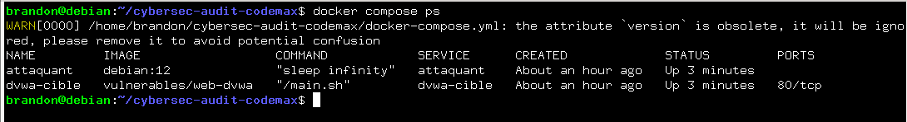
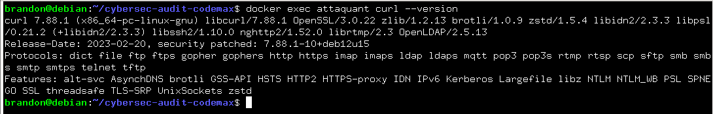
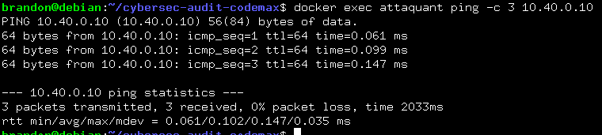
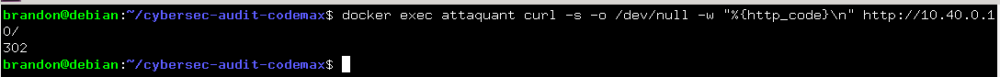
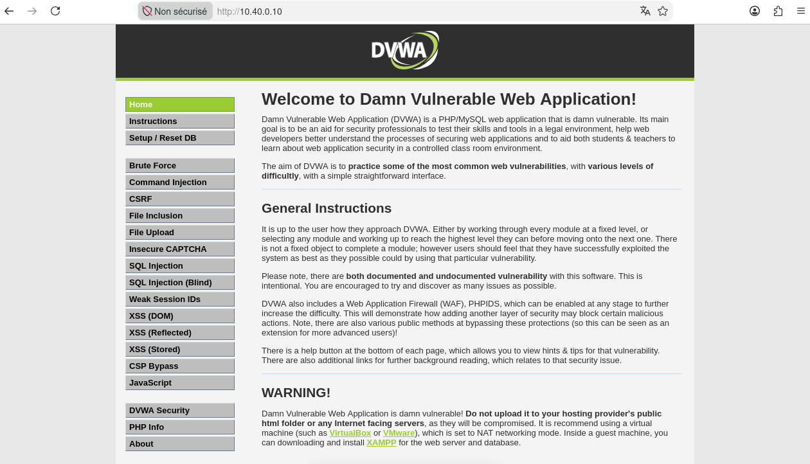

# Audit de sécurité - Plateforme Code un max

## 1. Définition de la Triade CIA appliquée à la plateforme Code un max
**Confidentialité** : Permet d'assurer que seules les personnes autorisées peuvent accéder au contenus.
**Intégrité** : Permet de garantir que le contenu ne peut pas être modifiés ou corrompus de manière non autorisée.
**Disponibilité** : Permet de s'assurer que le contenu reste acessible en toute circonstance sans interruption majeur.

## 2. Différence entre menace, vulnérabilité, risque et exploit
**Menace** : Une menace peut être un acteur ou un événement potentiel susceptible d'exploiter une faille pour nuire au système.
**Vulnérabilité** : C'est une faiblesse ou un défaut dans la conception, dans du code ou la configuration d'un système.
**Risque** : C'est la probalité qu'une menace exploite une vulnérabilité, combiné à l'impact que cela pourrait engendrer sur une entreprise.
**Exploit** : C'est un code ou une technique concrète utilisée pour exploiter une vulnérabilité.

## 3. Surface d'attaque du lab

**Réseau et Hôte** : Le lab repose sur un réseau virtuel de type bridge (`cyberlab-net` en `10.40.0.0/16`) interconnectant deux conteneurs :
- La cible : `dvwa-cible` avec l'adresse ip `10.40.0.10` qui héberge l'application web vulnérable
- L'attaquant: `attaquant` avec l'adresse ip `10.40.0.20` configuré pour effectuer les tests avec différents outils
Le point d'entrée est l'interface web HTTP de l'application web DVWA, qui est accessible depuis le réseau interne du lab

## 4. Bonus

### Responsabilité partagée
La plateforme Code un max est hébergé dans le Cloud, la sécurité est répartie selon deux axes : 
- Ce qui relève du **fournisseur** : La sécurité physique des datacenters, des hôtes de virtualisation et de l'infrastructure réseau globale.
- ce qui relèbve de l'**entreprise** : La configuration des applications, la gestions des identités et des accès (IAM), l'application des correctifs sur les services déployés.

### Chiffrement et Hachage
**Chiffrement symétrique** : Utilise une seule et unique clé partagée pour chiffrer et déchiffrer les données
**Chiffrement asymétrique** : Utilise une paire de clés mathématiquement liées (une clé publique pour chiffrer et une clé privée pour déchiffrer).
**Hachage et salage** : Le hachage et la transformation irréversible d'une donnée à laquelle on ajoute une chaine de caractères aléatoire (le sel) avant le hachage pour empêcher l'utilisation de table de correspondance particulière.

## 5. Docker Compose
```yml
networks:
  cyberlab-net:
    driver: bridge
    ipam:
      config:
        - subnet: 10.40.0.0/16

services:
  dvwa-cible:
    image: vulnerables/web-dvwa
    container_name: dvwa-cible
    networks:
      cyberlab-net:
        ipv4_address: 10.40.0.10

  attaquant:
    image: debian:12
    container_name: attaquant
    networks:
      cyberlab-net:
        ipv4_address: 10.40.0.20
    cap_add:
      - NET_ADMIN
      - NET_RAW
    command: sleep infinity
    volumes:
      - .:/data
```

## 5.1 Bon fonctionnement de la stack
```bash
docker compose ps
``` 



## 6. Installation des outils dans la machine de l'attaquant
```bash
docker exec attaquant bash -c "apt-get update && apt-get install -y iputils-ping
curl"
```


## 7. Prouver que l'attaquant atteint la cible
```bash
docker exec attaquant ping -c 3 10.40.0.10
```


## 8. Confirmer que le service web DVWA répond
```bash
docker exec attaquant curl -s -o /dev/null -w "%{http_code}\n" http://10.40.0.10/
```


## 9. Iinitialiser la BDD DVWA
```bash
docker exec attaquant sh -c "rm -f /tmp/ck; curl -s -c /tmp/ck
http://10.40.0.10/setup.php | grep -oE '[a-f0-9]{32}' | head -1 | xargs -I TKN
curl -s -b /tmp/ck --data create_db=1 --data user_token=TKN
http://10.40.0.10/setup.php -o /dev/null; echo BASE_DVWA_PRETE"
```

## 10. Interface graphique de l'application web
