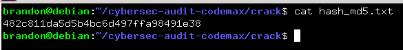
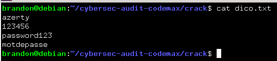
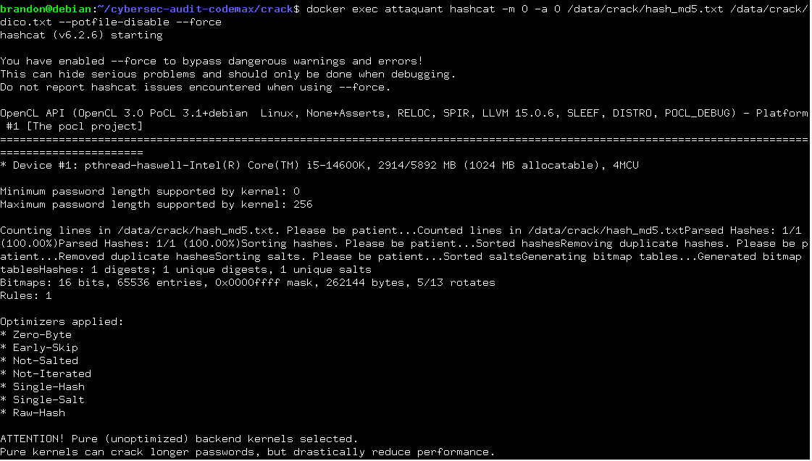
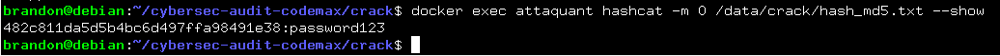
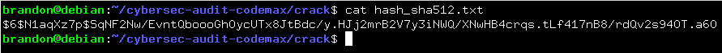
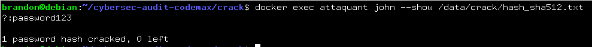

# Audit de securite - Plateforme Code un max

#### Casser des empreintes de mots de passe avec John the Ripper et Hashcat

---

## 1. Installation des outils
* John the Ripper : Un outil historique et polyvalent de cassage de mots de passe qui s'exécute principalement sur processeur (CPU) et excelle dans les attaques par dictionnaire ou par force brute.
* Hashcat : Le casseur de mots de passe le plus rapide au monde, optimisé pour utiliser la puissance des cartes graphiques (GPU) afin de craquer massivement et à très grande vitesse des empreintes numériques (hashs).
* OpenSSL : Une boîte à outils cryptographique fondamentale utilisée pour sécuriser les communications sur le web (génération de clés, certificats SSL/TLS, chiffrement et déchiffrement de fichiers).
```bash
docker exec attaquant bash -c "apt-get update && apt-get install -y john hashcat openssl
```

## 1.2 Création d'un dossier de travail dans le montage partagé
```bash
docker exec attaquant mkdir -p /data/crack
```

## 2. Génération d'une empreinte MD5 non salée d'un mot de passe faible
```bash
docker exec attaquant bash -c "echo -n password123 | md5sum | cut -d ' ' -f1 > /data/crack/hash_md5.txt"
```



## 3. Constitution d'une liste de mots de passe
```bash
docker exec attaquant bash -c "printf 'azerty\n123456\npassword123\nmotdepasse\n' > /data/crack/dico.txt"
```



## 4. Lancer une attaque par dictionnaire
```bash
docker exec attaquant hashcat -m 0 -a 0 /data/crack/hash_md5.txt /data/crack/dico.txt --force
```


## 4.1 Affiché le résultat trouvé
```bash
docker exec attaquant hashcat -m 0 /data/crack/hash_md5.txt --show
```


## 5. Génération d'une empreinte bcrypt salée du même mot de passe
```bash
docker exec attaquant bash -c "openssl passwd -6 -salt N1aqXz7p password123 > /data/crack/hash_sha512.txt"
```


### 5.1 Cassage du mot de passe avec John The Ripper
```bash
docker exec attaquant john --wordlist=/data/crack/dico.txt /data/crack/hash_sha512.txt
```

### 5.2 Affichage du résultat
```bash
docker exec attaquant john --show /data/crack/hash_sha512.txt
```



## 6. Conclusion

### 6.1 Constat de l'audit
* **Stockage vulnérable** : L'utilisation d'algorithmes rapides non salés (ex: MD5) permettent un cassage pratiquement instantané par dictionnaire ou tables arc-en-ciel.
    - Une **table arc-en-ciel** est une base de données précalculer utlisée en cryptanalyse pour retrouver des mots de passes en clair à partir de leurs empreintes numériques.
* **Politique de mots de passe** : L'exposition de mots de passe faibles et courants (ex: `password123`, `azerty`). La wordlist la plus célèbre et la plus utilisée et la wordlist `rockyou.txt` du même nom que de l'entreprise qui a subit une cyberattaque en décembre 2009. 

### 6.2 Contre-mesures et recommandations
* **Hachage robuste et lent** : Remplacer des algorithmes rapides comme MD5 par des algorithmes de hache lents comme `bcrypt`. Ils intègrent un "sel" qui est une donnée aléatoire unique ajoutée au mot de passe et demande un effort de calcul volontairement élevé au serveur. Cela permet de rendre le cassage très coûteux en temps pour un attaquant. Le but est de ralentir voir dissuader l'attaquant.
* **Politique de mot de passe stricte** : Imposer une longueur minimal stricte (par exemple 16 caractères). A savoir qu'une phrase longue peut être beaucoup mieux qu'un mot de passe avec des mininuscules, majuscules, chiffres et caractères spéciaux.
* **Limitation des requêtes (Rate limiting)** : Consiste à bloquer ou ralentir les adresses IP qui tentent un trop grond nombre de connexions en peu de temps pour empêcher les attaques automatisées.
* **Vérouillage de compte** : Suspendre temporairement un compte après un nombre limité de tentatives par exemple blocage après 5 échecs.
* **MFA** : Aujourd'hui, il faut activer l'authentification multifacteur (SMS, application d'authentification) pour éviter qu'un mot de passe volé ne suffise plus à compromettre un compte.
